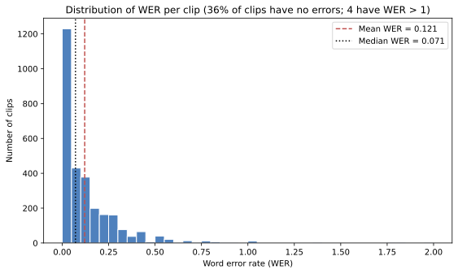
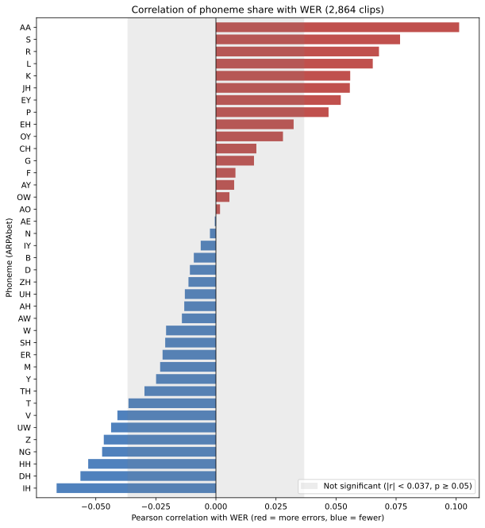
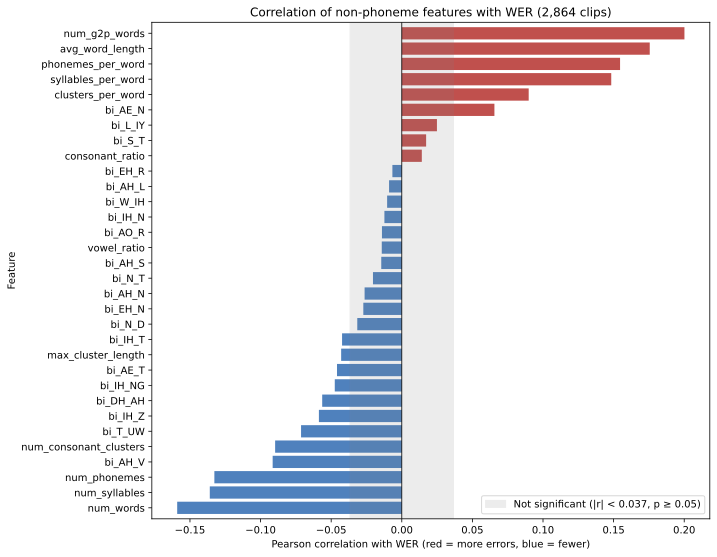
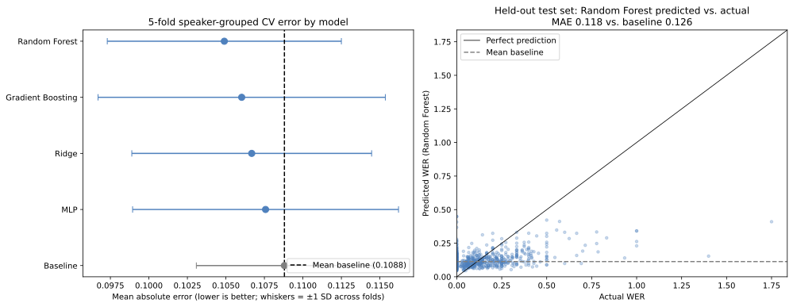

# Analyzing and Predicting Speech Recognition Errors Using Phonetic Patterns
## Description:

This project investigates whether the phonetic composition of a spoken sentence can predict the Word Error Rate (WER) of an automatic speech recognition (ASR) system. We use two LibriSpeech splits, which pair read English audio with verified transcripts: `dev-other` (2,864 clips, 33 speakers) for exploratory analysis and `train-other-500` (148,688 clips, 1,166 speakers) for modeling. Each clip was transcribed with OpenAI Whisper Base English (`base.en`), and the output was compared with the reference transcript to compute WER.

The reference transcripts were converted into phoneme sequences with the CMU Pronouncing Dictionary, using g2p-en for words it is missing. From these sequences we extract sentence-level features such as phoneme frequencies, vowel and consonant proportions, phonemes per word, consonant clusters and common phoneme bigrams. We then train regression models to predict each clip's WER from these features.

## Research Question

Can we predict the WER of an audio clip using features derived from the phoneme composition of its reference transcript?

**Success criterion:** a model beats a baseline that predicts the mean training WER for every clip, measured by mean absolute error (MAE) on speakers the model has never seen. A secondary goal is to identify which phonemes and phonetic patterns are associated with higher WER.

## Current Progress

### Data Visualizations

`visualize_data.py` produces three exploratory charts from the dev-other features:

- **WER distribution** (`wer_distribution.svg`): a histogram of per-clip WER, with the mean and median marked. The title gives the share of clips with no errors and the number of clips with WER above 1.
- **Phoneme correlations** (`phoneme_corr.svg`): the Pearson correlation between WER and each of the 39 phoneme shares. A shaded band marks correlations that are not significant at p < 0.05 (|r| < 1.96 / √n).
- **Feature correlations** (`feature_corr.svg`): the same chart for the length, vowel/consonant, cluster, out-of-dictionary and bigram features.





What the dev-other charts show (2,864 clips; correlations with |r| < 0.037 are not significant):

- **WER is heavily right-skewed.** 36% of clips have no errors. The median WER is 0.071, but the mean is pulled up to 0.121 by a long tail, and 4 clips have WER above 1 (more inserted words than the reference has).
- **Length and word difficulty have the strongest correlations.** WER goes up with the number of words missing from CMUdict (`num_g2p_words`, r = +0.20), average word length (+0.18), phonemes per word (+0.16) and syllables per word (+0.15). These are mostly names and long, rare words. WER goes down for longer clips (`num_words` -0.16, `num_syllables` -0.14, `num_phonemes` -0.13), partly because a single error counts for less in a long clip.
- **Common function words are linked to fewer errors.** Bigrams from very frequent words have negative correlations: `bi_AH_V` ("of", -0.09), `bi_DH_AH` ("the", -0.06), `bi_IH_Z` ("is", -0.06) and `bi_IH_NG` ("-ing", -0.05). So do the phonemes that make up those words: IH (-0.07), DH (-0.06), HH (-0.05), Z and NG (both -0.05).
- **Some phonemes are linked to more errors.** AA (+0.10), S (+0.08), R (+0.07), L (+0.07), K and JH (both +0.06), EY (+0.05) and P (+0.05) are positively correlated with WER. 15 of the 39 phonemes and 18 of the 32 other features fall outside the non-significance band.
- **Every correlation is weak on its own.** The largest is |r| = 0.20 (`num_g2p_words`), so no single feature explains much of WER. This fits the modest R² of the models below.

An earlier version of `train_models.py`, run on dev-other only, also produced `model_performance.svg`. It compared Ridge, Random Forest, Gradient Boosting and an MLP with 5-fold speaker-grouped CV. Random Forest ranked best and the mean baseline had a CV MAE of 0.1088. On held-out speakers, Random Forest's MAE was 0.118, against 0.126 for the baseline. With only 33 speakers, this result was noisy, so the models are now trained on train-other-500.



The training scripts produce two more charts from train-other-500, saved in `data/`:

- **Classical model performance** (`classical_model_performance.svg`, from `train_models.py`). The left panel shows each model's 5-fold speaker-grouped CV MAE, with whiskers of ±1 fold standard deviation. All three models beat the mean baseline (0.064). Random Forest is best (0.0562), just ahead of Histogram Gradient Boosting (0.0565), with Ridge at 0.0583. The fold-to-fold spread is about ±0.002, so the three models overlap. The right panel plots Random Forest's predicted WER against actual WER for the unseen test speakers. Test MAE is 0.0588, against 0.0665 for the baseline.
- **Neural network performance** (`nn_model_performance.svg`, from `train_nn.py`). The same predicted-vs-actual plot for the MLP. Its test MAE is 0.0589, against 0.0665 for the baseline, nearly identical to Random Forest.


In both predicted-vs-actual plots, most predictions are close to the mean: 98% fall between about 0.03 and 0.28, and the median is about 0.06. Actual WER is spread much more widely, with 1% of test clips above 0.5. Phonetic features give a consistent but small improvement over the baseline (about 12% lower MAE), and they don't predict which clips will have very high WER.

### Data Processing

- **Transcription:** we ran Whisper Base English (`base.en`) on two LibriSpeech splits: `dev-other` (2,864 clips, 33 speakers) and `train-other-500` (148,688 clips, 1,166 speakers).
- **WER:** before computing WER with JiWER, both the reference and the Whisper output go through Whisper's English text normalizer, so differences like "FIFTEEN" vs. "15" or "MR" vs. "Mr." are not counted as errors. Hyphens between letters are also removed, since LibriSpeech transcripts have none. Corpus WER is 6.50% on train-other-500 and 10.40% on dev-other.
- **Phonemes:** each reference transcript is converted to ARPAbet phonemes using the first CMUdict pronunciation, with stress markers removed. Words missing from CMUdict (mostly names and rare words) are pronounced with the g2p-en model instead. Word boundaries are kept so that clusters and bigrams never cross words.
- **Features:** each clip gets 71 features: 12 length, vowel/consonant, consonant-cluster and out-of-dictionary counts; the share of each of the 39 phonemes; and the share of the 20 most common within-word bigrams.
- **Avoiding leakage:** the models only see features computed from the reference transcript. Whisper's confidence (`avg_logprob`), audio length and processing time are kept out of the feature files, and the training scripts accept only the phonetic columns.

### Modeling Methods

Every model predicts a clip's WER from its 71 phonetic features and is compared with a **mean baseline** that predicts the average training WER for every clip.

| Model | Script | Settings |
| --- | --- | --- |
| Ridge regression | `train_models.py` | Standardized features, `alpha=10` |
| Random Forest | `train_models.py` | 100 trees, max depth 16, at least 10 clips per leaf, 80% of features per split |
| Histogram Gradient Boosting | `train_models.py` | Up to 200 iterations, learning rate 0.05, 15 leaves per tree, L2 regularization 1.0, early stopping |
| Neural network (MLP) | `train_nn.py` | Standardized features, hidden layers of 64 and 32 ReLU units, Adam, L2 penalty 1.0, batch size 1,024, early stopping |

**Evaluation:**
- Clips from the same speaker are never split between training and testing. 20% of the train-other-500 speakers are held out as a test set, so the models are tested on voices they have never heard.
- Models are compared using 5-fold cross-validation on the training speakers, also grouped by speaker, and ranked by mean absolute error (MAE). We also report RMSE and R².
- The best model is scored on the held-out speakers only once, after it has been chosen.

### Results & Interpretation

**Cross-validation (5 folds of training speakers, sorted by MAE)**

| Model | MAE (± fold SD) | RMSE | R² |
| --- | ---: | ---: | ---: |
| Random Forest | **0.0562** ± 0.0019 | **0.1191** | **0.173** |
| Histogram Gradient Boosting | 0.0565 ± 0.0019 | 0.1199 | 0.160 |
| Neural network (MLP) | 0.0571 ± 0.0016 | 0.1197 | 0.163 |
| Ridge | 0.0583 ± 0.0016 | 0.1212 | 0.138 |
| Mean baseline | 0.0639 ± 0.0021 | 0.1292 | -0.001 |

**Held-out test (unseen speakers)**

| Model | MAE | RMSE | R² |
| --- | ---: | ---: | ---: |
| Random Forest (best classical model in CV) | **0.0588** | 0.1076 | 0.201 |
| Neural network (MLP) | 0.0589 | **0.0990** | **0.323** |
| Mean baseline | 0.0665 | 0.1204 | -0.001 |

**Interpretation:**

- **The project's success criterion is met.** Every model beats the mean baseline on MAE, RMSE and R², in cross-validation and on speakers the models never saw. Random Forest, chosen by CV MAE, lowers test MAE from 0.0665 to 0.0588 (11.6% lower).
- **Phonetic composition explains a modest share of WER.** CV R² ranges from 0.14 (Ridge) to 0.17 (Random Forest), and test R² is 0.20 for Random Forest and 0.32 for the MLP. Most of the variation in WER comes from things the features don't capture, such as the speaker's voice, accent and recording conditions.
- **Nonlinear models help, but only a little.** Random Forest, Gradient Boosting and the MLP all beat Ridge, which suggests some interactions between features. The three nonlinear models are within about one fold standard deviation of each other in CV, so none of them is clearly better.
- **The MLP is better on large errors.** Its test MAE matches Random Forest, but its RMSE is lower (0.099 vs. 0.108) and its R² higher (0.32 vs. 0.20). RMSE and R² weight large errors more heavily, so the MLP predicts high-WER clips somewhat better. In CV, though, the MLP's R² was slightly lower than Random Forest's (0.163 vs. 0.173), so the test gap may partly reflect which speakers ended up in the single test split. Random Forest remains the model chosen by our protocol: the test set was only used to score it, not to pick it.
- **Very high WER is still unpredictable.** As the predicted-vs-actual plots show, predictions stay near the mean, while a small number of clips have WER above 0.5.
- **Which features matter:** the dev-other correlations (see Data Visualizations) point to word difficulty (out-of-dictionary words, long words) and clip length as the strongest signals, with common function words linked to fewer errors. We haven't yet computed model-based feature importances (for example, permutation importance on the test speakers). Doing so would show which features the trained models actually rely on.

## Next Steps

- **Model-based feature importance.** The correlations above look at one feature at a time. We will compute permutation importance for the trained models on the held-out speakers, and finish the greedy backward feature ablation in `feature_ablation.py`, to see which features the models actually rely on. This answers our secondary research question.
- **High-WER clips.** The models predict close to the mean and miss the clips with very high WER. We will look at those clips (and the clips with WER above 1) to see whether they share phonetic patterns, and decide whether to cap or exclude them.
- **Other ASR models.** If time permits, we will run a larger Whisper model (for example `small.en`) on the same clips to see whether the same phonetic patterns lead to errors across models.
- **Reproducibility for the final report.** Add a Makefile that installs dependencies and runs the pipeline, tests for the feature code, a GitHub Actions workflow that runs them, and fix the default file paths in `visualize_data.py` and `build_features.py`, which still point to the repository root instead of `data/`.

## How to Run

### Setup

Requires Python 3.10 or newer (we use 3.12).

```bash
git clone https://github.com/eshaanagarwal06/CS506_Final_Project.git
cd CS506_Final_Project

python -m venv .venv
source .venv/bin/activate        # Windows: .\.venv\Scripts\Activate.ps1

python -m pip install --upgrade pip
python -m pip install -r requirements.txt
python -m nltk.downloader averaged_perceptron_tagger_eng cmudict
```

The LibriSpeech audio is streamed from Hugging Face the first time you run the pipeline, so you don't need to download it separately.

### Pipeline

The project uses two LibriSpeech splits. `dev-other` (2,864 clips) is used for exploratory analysis. `train-other-500` (148,688 clips) is used to train and evaluate the models.

Run every command from the repository root. `prepare_data.py`, `build_features.py` and `visualize_data.py` read and write paths relative to the current folder. The training scripts find the `data/` folder on their own.

**1. Explore dev-other**

```bash
python prepare_data.py
python build_features.py
python visualize_data.py
```

**2. Train on train-other-500**

```bash
python phonemes.py data/train-other-500_base.en_results.csv data/train-other-500_base.en_processed.csv.gz
python build_features.py data/train-other-500_base.en_processed.csv.gz data/train-other-500_base.en_features.csv.gz
python train_models.py
python train_nn.py
```

| Step | What it does | Output |
| --- | --- | --- |
| `prepare_data.py` | Transcribes each clip with Whisper, computes WER against the LibriSpeech transcript (both normalized with Whisper's English normalizer), and converts the transcript to phonemes with CMUdict (falling back to G2P for words missing from CMUdict, mostly names), keeping word boundaries. The phoneme code lives in `phonemes.py` | `dev-other_base.en_processed.csv` |
| `phonemes.py` | Adds the phoneme columns to a results CSV that already has WER, so Whisper doesn't need to rerun | `data/train-other-500_base.en_processed.csv.gz` |
| `build_features.py` | Builds one row of phonetic features per clip, plus `wer`, and prints the 10 features most correlated with WER | `dev-other_base.en_features.csv`, `data/train-other-500_base.en_features.csv.gz` |
| `visualize_data.py` | Plots each feature's correlation with WER on dev-other, with the p < 0.05 significance band, and the distribution of WER | `phoneme_corr.svg`, `feature_corr.svg`, `wer_distribution.svg` |
| `train_models.py` | Compares a mean baseline, Ridge, Random Forest and Histogram Gradient Boosting with 5-fold cross-validation grouped by speaker, then scores the best model and the baseline once on a held-out set of unseen speakers | `data/classical_cv_scores.csv`, `data/classical_test_scores.csv`, `data/classical_model_performance.svg` |
| `train_nn.py` | Runs the same cross-validation and held-out test for a neural network (scikit-learn `MLPRegressor`). It is kept separate from `train_models.py` so it can be developed independently | `data/nn_cv_scores.csv`, `data/nn_test_scores.csv`, `data/nn_model_performance.svg` |

`prepare_data.py` is the slowest step. On the full dev-other split it took about 10 minutes on an M4 Max, and it will be much slower on older laptops. It saves a checkpoint (`*.partial.csv`) every 250 clips. The other dev-other steps take about 15 seconds in total. On train-other-500, `phonemes.py` and `build_features.py` take about 30 and 40 seconds on an M4 Max.

Both feature files are committed, so you can skip straight to `visualize_data.py` or to the training scripts without rerunning Whisper or rebuilding features. `data/train-other-500_base.en_results.csv` is not run through Whisper here: it already has Whisper transcripts and WER for all 148,688 clips.

Paths ending in `.gz` are compressed, because the uncompressed files would be over GitHub's 100 MB limit. The train-other-500 feature file (21 MB) is committed. The processed file (55 MB) is not, since `phonemes.py` rebuilds it in about 30 seconds (see step 2 above).

### Training scripts

`train_models.py` and `train_nn.py` use the same data, split and metrics, so their scores can be compared directly:

- **Features:** only the 71 phonetic columns (the scalar features below plus every `ph_` and `bi_` column). IDs, `wer`, Whisper outputs and timing columns are never used as inputs.
- **Split:** 20% of speakers are held out as the test set (`GroupShuffleSplit`, `random_state=42`). No speaker appears in both training and test data.
- **Validation:** cross-validation on the training speakers only, grouped by speaker (`GroupKFold`).
- **Metrics:** MAE, RMSE and R². Models are ranked by CV MAE. The held-out test set is scored once, after the model is chosen.
- **Baseline:** predicts the mean training WER for every clip.

`train_models.py` and `train_nn.py` keep `RANDOM_STATE`, `TEST_SIZE` and `DEFAULT_CV_FOLDS` at the top of each file, and these must stay identical.

| Option | Scripts | Default | Meaning |
| --- | --- | --- | --- |
| `--data` | both | `data/train-other-500_base.en_features.csv.gz`, else the uncompressed `.csv` | Feature file to train on |
| `--cv-folds` | both | 5 | Number of speaker-grouped CV folds. Use `--cv-folds 3` for a quicker run, and pass the same value to `train_models.py` and `train_nn.py` when comparing them |

### Settings

The Whisper settings are at the top of `prepare_data.py`:

- `DATASET_NAME`: which LibriSpeech split to use (`dev-clean`, `dev-other`, `test-clean`, `test-other`).
- `MODEL_NAME`: the Whisper model (for example `tiny.en`, `base.en`, `small.en`).
- `NUM_CLIPS`: how many clips to process. `None` processes the whole split; a small number like `20` is useful for a quick test.

`phonemes.py` and `build_features.py` take input and output paths as arguments (`build_features.py` defaults to the dev-other files). `visualize_data.py` is still hardcoded to the dev-other feature file; update `DATA_FILE` to plot another split. The training scripts take `--data` (see above).

The 20 bigram columns are the split's own most common bigrams, so they differ slightly between splits (`bi_AH_T` for train-other-500, `bi_AH_S` for dev-other). To give a split the same columns as another, pass `--bigrams-from` with that split's feature file, for example `--bigrams-from data/train-other-500_base.en_features.csv.gz`.

The train-other-500 results CSV also has `avg_logprob`, `audio_seconds` and `processing_seconds`. These come from Whisper or the audio, not the transcript, so `build_features.py` leaves them out.

### Feature columns

Both feature files have `audio_id`, `speaker_id`, `wer`, and these 71 features:

- **Length:** `num_words`, `avg_word_length` (letters), `num_phonemes`, `phonemes_per_word`, `num_syllables` (vowel phonemes), `syllables_per_word`
- **Vowels and consonants:** `vowel_ratio`, `consonant_ratio`
- **Consonant clusters** (2+ consonants in a row within one word): `num_consonant_clusters`, `clusters_per_word`, `max_cluster_length`
- **Out-of-dictionary words:** `num_g2p_words`, the number of words missing from CMUdict
- **Phonemes:** `ph_<PHONEME>`, the share of the clip's phonemes that are that phoneme (39 columns)
- **Bigrams:** `bi_<A>_<B>`, the share of the clip's within-word phoneme bigrams that are that bigram, for the 20 most common bigrams in the split

## CSV summary

Each data CSV has one row per audio clip. The transcription files use Whisper Base English (`base.en`).

| File | LibriSpeech split | Contents | Clips | Speakers | Corpus WER | Mean clip WER |
| --- | --- | --- | ---: | ---: | ---: | ---: |
| [`train-other-500_base.en_results.csv`](data/train-other-500_base.en_results.csv) | `train-other-500` | Transcripts, errors, confidence, and timing | 148,688 | 1,166 | 6.50% | 7.47% |
| [`train-other-500_base.en_features.csv.gz`](data/train-other-500_base.en_features.csv.gz) | `train-other-500` | Model input with 71 features, used by the training scripts | 148,688 | 1,166 | 6.50% | 7.47% |
| [`dev-other_base.en_processed.csv`](data/dev-other_base.en_processed.csv) | `dev-other` | Current transcripts and phonemes | 2,864 | 33 | 10.40% | 12.12% |
| [`dev-other_base.en_features.csv`](data/dev-other_base.en_features.csv) | `dev-other` | 71 features, used by `visualize_data.py` | 2,864 | 33 | 10.40% | 12.12% |
| [`dev_other_results_base.en.csv`](data/dev_other_results_base.en.csv) | `dev-other` | Earlier transcription export | 2,864 | 33 | 10.44% | 12.17% |
| [`dev-other_base.en_phonemes.csv`](data/dev-other_base.en_phonemes.csv) | `dev-other` | Earlier CMUdict phoneme export | 2,864 | 33 | 10.44% | 12.17% |
| [`dev-other_base.en_phonemes_complete.csv`](data/dev-other_base.en_phonemes_complete.csv) | `dev-other` | Earlier phoneme export with G2P fallback | 2,864 | 33 | 10.44% | 12.17% |

Corpus WER divides all word errors by all reference words. Mean clip WER gives every clip equal weight. The CSVs store `wer` as a fraction (for example, `0.10` means 10%).

The feature files carry over the WER values from the files they were built from. All five `dev-other` files cover the same clips. Ten clips have different WER values between the earlier exports and the current pipeline outputs.

The processed files add `phonemes`, `word_phonemes` (the same phonemes with ` | ` between words), `num_phonemes`, `g2p_words` and `unresolved_words` to the transcription columns.

The `train-other-500` CSV records 315,674 errors across 4,858,957 normalized reference words. Reference transcripts come from the [LibriSpeech ASR Corpus](https://www.openslr.org/12/) by Panayotov, Chen, Povey, and Khudanpur, licensed under [CC BY 4.0](https://creativecommons.org/licenses/by/4.0/).

### Model output files

The training scripts write these to `data/`. Each has one row per model.

| File | Written by | Contents |
| --- | --- | --- |
| `classical_cv_scores.csv` | `train_models.py` | CV MAE, MAE standard deviation across folds, RMSE and R² for the baseline and each classical model |
| `classical_test_scores.csv` | `train_models.py` | MAE, RMSE and R² on the held-out speakers for the best classical model and the baseline |
| `nn_cv_scores.csv` | `train_nn.py` | The same CV scores for the neural network |
| `nn_test_scores.csv` | `train_nn.py` | Held-out scores for the neural network and the baseline |

## Resources

- [LibriSpeech ASR Corpus](https://www.openslr.org/12/) – Speech dataset containing audio recordings paired with ground-truth transcripts.
- [CMU Pronouncing Dictionary (CMUdict)](https://github.com/cmusphinx/cmudict) – English pronunciation dictionary used to convert words into phoneme sequences.
- [JiWER](https://github.com/jitsi/jiwer) – Python package for calculating Word Error Rate (WER) and other ASR evaluation metrics.
- [OpenAI Whisper](https://github.com/openai/whisper) – Automatic speech recognition model that can be used to generate predicted transcripts.
- [Mozilla Common Voice](https://commonvoice.mozilla.org/datasets) – Large crowdsourced speech dataset that could be used as an extension for testing more diverse speakers and accents.
- [G2P (Grapheme-to-Phoneme) – g2p-en](https://github.com/Kyubyong/g2p?utm_source=chatgpt.com) – Python package used to convert text into phoneme sequences, complementing CMUdict by predicting pronunciations for words not found in the dictionary.
